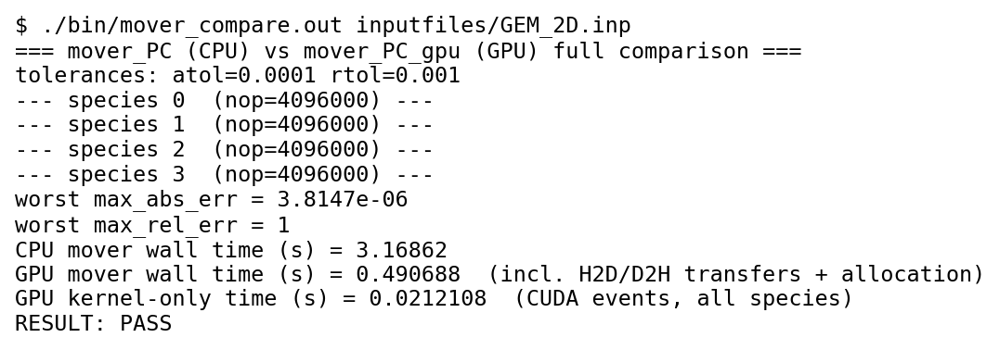
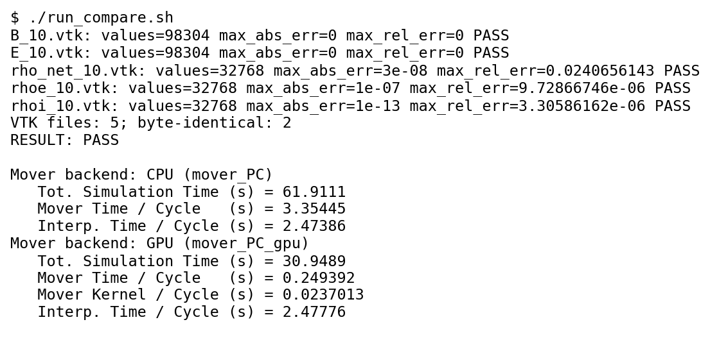

# Bonus: iPIC3D-mini GPU particle mover (`mover_PC_gpu`)

The upstream source is `KTH-ScaLab/DD2360-HT25` at commit
`53e7ca59d1904f586b2940d2cfc3f30351873e7b`, in subfolder `iPIC3D-mini/`.
The source is included under `a2/Bonus/iPIC3D-mini/` without a nested `.git`.
`GEM_2D.inp` remains unmodified at
`a2/Bonus/iPIC3D-mini/inputfiles/GEM_2D.inp` and is used for every run below.

The measurements come from a Google Colab Tesla T4 runtime with CUDA 13.0.88.
Both the GPU run and the complete ten-cycle CPU run finished. Raw logs,
numerical comparisons and output figures are in `a2/Bonus/results/`.

## 1. Environment, Makefile changes and execution

The reported runs used Google Colab with a Tesla T4 (compute capability 7.5),
driver 580.82.07 and CUDA 13.0.88. The GPU build used `ARCH=sm_75`. The
Makefile also supports other Linux CUDA machines, while the CPU baseline needs
only `g++`.

The Makefile at `a2/Bonus/iPIC3D-mini/Makefile` has these changes:

- `ARCH` can be overridden with `make ARCH=sm_80`. If unset,
  `nvidia-smi --query-gpu=compute_cap` detects it (for example, `8.0 →
  sm_80`), with `sm_70` as the fallback. The upstream default was `sm_30`.
- `make` and `make gpu` build `bin/miniPIC_gpu.out` with nvcc.
- `make cpu` builds `bin/miniPIC_cpu.out` with g++ and the original CPU mover.
- `make compare` builds `bin/mover_compare.out` for the CPU/GPU mover check.
- Objects go to `obj/cpu`, `obj/gpu` and `obj/cmp`, with separate binaries for
  each target. This prevents stale objects from mixing CPU and GPU builds.
  The upstream Makefile placed all objects in `src/`.
- The GPU build defines `-DUSE_GPU_MOVER` for every translation unit, and the
  driver calls `mover_PC_gpu()`. The CPU build calls the untouched
  `mover_PC()`. Each binary prints `Mover backend: ...` at startup.
- `make clean` removes `obj/` and `bin/`.
- CUDA headers in `include/Alloc.h` and `src/Particles.cu` are guarded by
  `#ifdef __CUDACC__`, so the CPU build does not require them.

Run the GEM_2D case with 10 cycles, 4 species and approximately 16.4 M
particles:

```bash
cd a2/Bonus/iPIC3D-mini
make cpu                      # bin/miniPIC_cpu.out
mkdir -p data && ./bin/miniPIC_cpu.out inputfiles/GEM_2D.inp | tee cpu.log
make                          # bin/miniPIC_gpu.out (+ mover_compare.out)
rm -rf data && mkdir -p data && ./bin/miniPIC_gpu.out inputfiles/GEM_2D.inp | tee gpu.log
```

`../run_compare.sh` runs both versions and compares their output files (see
§3).

## 2. GPU design of `mover_PC()`

The new symbols are in `src/Particles.cu` and declared in
`include/Particles.h` under `__CUDACC__`/`USE_GPU_MOVER`.

`__global__ void mover_pc_kernel(...)` assigns one thread to each particle,
with `blocks = ceil(nop/256)`. Each thread executes that particle's
`n_sub_cycles` subcycles and `NiterMover` predictor-corrector iterations in the
CPU order: trilinear G2P interpolation, Boris-style velocity solve, position
update and the three directional boundary conditions. The index calculation
uses `double` to match CPU promotion for the `grid` members. Periodic and
reflecting conditions come from `param->PERIODIC*`.

`int mover_PC_gpu(struct particles*, struct EMfield*, struct grid*, struct parameters*)`
is the host wrapper. On every call, it allocates device memory and copies six
particle arrays, six field flats (`Ex_flat … Bzn_flat`) and three coordinate
flats (`XN_flat/YN_flat/ZN_flat`) to the GPU. After the kernel, it copies the
six particle arrays back and frees the allocations.

The memory and indexing scheme follows the upstream layout:

- The upstream `*_flat` arrays are contiguous and can be copied directly with
  `cudaMemcpy`. The device never dereferences host `***Ex`-style pointer
  chains.
- `get_idx(ix,iy,iz,nyn,nzn) = nyn*nzn*ix + nzn*iy + iz` from `Alloc.h` gives
  the same layout as the host, so
  `flat[get_idx(ix,iy,iz,nyn,nzn)] ≡ A[ix][iy][iz]`.
- A POD `struct MoverGPUConst` passes grid and mover constants by value.
- If `nop == 0`, the wrapper returns 0 without a CUDA call.
- Every `cudaMalloc`, `cudaMemcpy`, event call and kernel launch is checked.
  The launch check uses `cudaGetLastError()` and event synchronization. On an
  error, the wrapper prints the file, line and `cudaGetErrorString`, then
  returns nonzero so the driver can stop. `DeviceBuffer` and `EventGuard`
  release device resources on error paths.
- CUDA events around the launch measure kernel-only time, excluding transfers
  and allocation. `mover_pc_gpu_kernel_time_sec()` accumulates this value, and
  the driver divides it by `ncycles`. It prints `Mover Kernel / Cycle (s)`
  beside the end-to-end `Mover Time / Cycle (s)`, which includes H2D/D2H in the
  GPU binary. The two timers distinguish kernel time from end-to-end speedup.

## 3. Correctness: CPU and GPU comparison

### Mover-level full comparison

The checker is `src/mover_compare.cu`, built as `bin/mover_compare.out`:

```bash
./bin/mover_compare.out inputfiles/GEM_2D.inp          # default atol=1e-4 rtol=1e-3
./bin/mover_compare.out inputfiles/GEM_2D.inp 1e-4 1e-3
```

It creates the simulation's initial state with `initGEM`. For each species, it
deep-copies the pristine `x/y/z/u/v/w` arrays, runs `mover_PC()` on one copy and
`mover_PC_gpu()` on the other, then compares every element of all six arrays.
It reports `max_abs_err` and `max_rel_err` for each species and array, including
the worst element index, CPU/GPU wall times and CUDA-event kernel time.

The per-element criterion is `|gpu−cpu| ≤ atol + rtol·|cpu|`, with defaults
`atol = 1e-4, rtol = 1e-3`. This allows ULP-level float/FMA contraction
differences. Wrong indices, missing boundary conditions and wrong subcycle
order produce errors orders of magnitude larger. Exit code `0` means PASS,
`1` means FAIL and `2` means a usage error, which lets scripts check the
result.

### Full-simulation output comparison

Run `a2/Bonus/run_compare.sh`:

```bash
cd a2/Bonus && ./run_compare.sh        # or: ./run_compare.sh iPIC3D-mini/inputfiles/GEM_2D.inp
```

The script runs both binaries on `GEM_2D.inp` in separate directories, then
runs `diff -r` and `compare_vtk.py` on the `data/` VTK output trees. The Python
checker parses every ASCII scalar/vector payload, rejects NaN/Inf and applies
the same combined absolute/relative tolerance. It writes `data.diff` and
`numeric_compare.txt`, and exits nonzero on a numerical failure.

The Colab mover run covered four species with 4,096,000 particles each:
16,384,000 particles and 98,304,000 values across six arrays. Every value
passed `atol=1e-4, rtol=1e-3`, and the worst absolute error was `3.8147e-6`.
The reported worst relative error of 1 belongs to a near-zero CPU velocity
component; its absolute error is `5.96046e-8`. Per-species and per-array errors
are in `results/mover_compare.txt`.



Both binaries completed all ten GEM_2D cycles. At cycle 10, `E_10.vtk` and
`B_10.vtk` were byte-identical. All 32,768 values in each density file passed,
with maximum absolute errors of `1e-7` for electron density, `1e-13` for ion
density and `3e-8` for net density. Two of the five VTK files were therefore
byte-identical, and all five passed the numerical test. See
`results/vtk_numeric_compare.txt` and `results/data.diff`.

## 4. Execution-time comparison

The binaries print three timing scopes:

| Quantity | Where | Scope |
|---|---|---|
| `Mover Time / Cycle (s)` | both binaries, end of run | Wall time around the whole mover phase per cycle. For the GPU, this includes allocation, H2D, kernel and D2H. |
| `Mover Kernel / Cycle (s)` | GPU binary only | CUDA events around the kernel launch only |
| `CPU/GPU mover wall time`, `GPU kernel-only time` | `mover_compare` output | Single-mover-call comparison on identical data |

The measured Colab times are:

| Measurement | CPU (s) | GPU end-to-end (s) | GPU kernel only (s) | CPU / GPU end-to-end |
|---|---:|---:|---:|---:|
| One mover call, all four species | 3.16862 | 0.490688 | 0.0212108 | 6.46x |
| Mover per cycle, complete simulation | 3.35445 | 0.249392 | 0.0237013 | 13.45x |
| Whole ten-cycle simulation | 61.9111 | 30.9489 | N/A | 2.00x |

The end-to-end mover comparison includes allocation and H2D/D2H transfers,
giving a 13.45x speedup. The kernel-only time is separate and is not the
end-to-end denominator. Allocation, transfers and launch overhead take about
`0.249392 - 0.0237013 = 0.22569 s`, or 90.5% of GPU mover time per cycle.
CPU interpolation takes about 2.474 s per cycle and 2.478 s in the GPU run,
which limits whole-simulation speedup to 2.00x. Raw timings are in
`results/timing.txt`, `results/cpu_console.log` and
`results/gpu_console.log`.



## File and symbol index

| File | Change |
|---|---|
| `iPIC3D-mini/Makefile` | dual `cpu`/`gpu`/`compare` targets, per-target object dirs, `ARCH` auto-detect (no `sm_30` default) |
| `iPIC3D-mini/include/Particles.h` | declarations of `mover_PC_gpu()`, `mover_pc_gpu_kernel_time_sec()`, `mover_pc_gpu_reset_kernel_time()` |
| `iPIC3D-mini/src/Particles.cu` | original `mover_PC()` untouched; added `MoverGPUConst`, `mover_pc_kernel`, RAII `DeviceBuffer`/`EventGuard`, `mover_PC_gpu()` with full CUDA error checking and kernel-event timing |
| `iPIC3D-mini/src/sputniPIC.cpp` | compile-time `MOVER_FN` selection (`-DUSE_GPU_MOVER`), mover error propagation, `Mover backend` / `Mover Kernel / Cycle` output |
| `iPIC3D-mini/src/mover_compare.cu` | new standalone CPU-vs-GPU mover correctness tool (full comparison, exit-code verdict) |
| `iPIC3D-mini/include/Alloc.h` | `#ifdef __CUDACC__` guard so the pure-CPU build needs no CUDA headers |
| `iPIC3D-mini/inputfiles/GEM_2D.inp` | unchanged upstream reproduction input |
| `run_compare.sh` | full GEM_2D CPU/GPU run + byte/numerical output comparison + timing extraction |
| `compare_vtk.py` | compares every ASCII VTK payload value, rejects non-finite results and exits nonzero on error |
| `results/` | actual Colab logs, errors, timings, VTK comparison and output figures |
