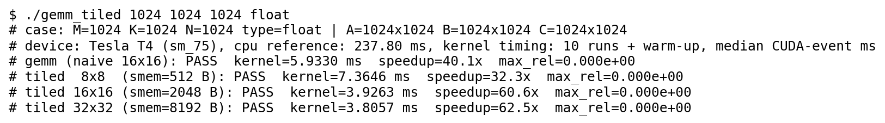
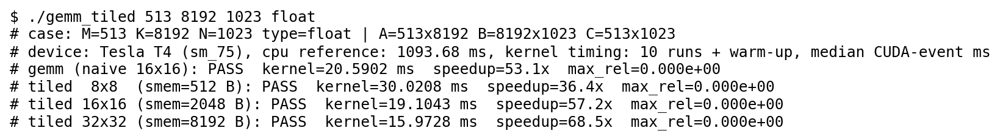
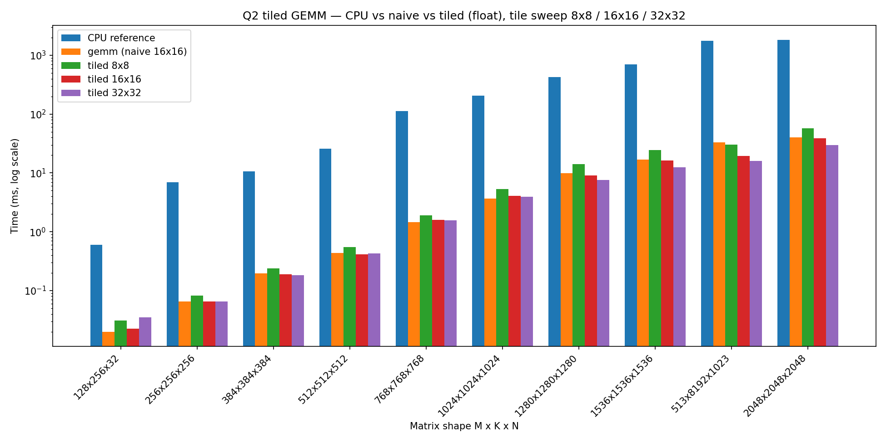

# Question 2: Tiled matrix multiplication

This program computes row-major `C(M x N) = A(M x K) * B(K x N)` in `double`
or `float`. It includes the naive CUDA kernel `gemm()`, the shared-memory
kernel `tiled_gemm()` with runtime `tileX`/`tileY` sizes, a full CPU reference,
CUDA-event timing and a benchmark sweep with a grouped bar chart.

## Files

| File | Purpose |
|---|---|
| `gemm_tiled.cu` | Single source: CPU reference, `gemm()`, `tiled_gemm()`, validation, timing, CSV output. |
| `Makefile` | `nvcc -O3 -std=c++17 -arch=$(ARCH)` build (`ARCH=sm_75` default, matching the A1 T4/Colab run). |
| `benchmark.py` | Runs an increasing size sweep, writes `results/timing_*.csv` and a grouped bar chart `results/timing_*.png`. Exits with an error on a failed run or missing data. |

## Build and run

```bash
make                       # or: nvcc -O3 -std=c++17 -arch=sm_75 gemm_tiled.cu -o gemm_tiled
./gemm_tiled 1024 1024 1024            # report question 2 shape (default sweep)
./gemm_tiled 513 8192 1023             # report question 3 shape (non-divisible M/N)
./gemm_tiled 128 256 32 float          # small float case
./gemm_tiled 512 512 512 double 8 8 16 16 32 32   # explicit tile pairs (optional CLI)
python3 benchmark.py ./gemm_tiled --outdir results          # full sweep
python3 benchmark.py ./gemm_tiled --type float --outdir results
```

The CLI is `./gemm_tiled M K N [double|float] [tileX tileY]...`, where `A` is
`M x K`, `B` is `K x N` and `C` is `M x N`. The default sweep uses `8x8`,
`16x16` and `32x32`. Invalid arguments produce an error and a nonzero exit
code.

## Timing and validation

- Each kernel has one untimed warm-up launch followed by `GEMM_REPS` timed
  launches. The default is 10, and `time_ms` is the median CUDA-event duration.
  The program checks every launch with `cudaGetLastError` and synchronizes each
  event pair. Set `GEMM_REPS=1` for one un-warmed run under `ncu`, where
  profiling replays make repeated launches expensive. Non-numeric and `<= 0`
  values are errors. Warm-up removes first-run jitter that made independent
  runs differ from sweep runs by up to ~2x.
- `std::chrono` measures the single full CPU reference.
- The CPU reference covers every case in full. Each GPU result is compared
  element by element (`O(M*N)` per kernel), so the CSV always records `full`.
  The tolerance is `|err| <= atol + rtol*|ref|`, with `atol = rtol = 1e-9` for
  double and `1e-3` for float. A validation failure exits nonzero.
- Before launch, the program checks size overflow, `tileX*tileY <= 1024`
  threads/block, `grid.y <= 65535`, and that
  `(tileY*tileX + tileX*tileX)*sizeof(T)` fits within `sharedMemPerBlock`.
  Every CUDA call goes through `CHECK_CUDA`.

## Output format

For each case, stdout contains a `#` comment block with the device name, CPU
reference time, timing mode, per-kernel PASS/FAIL, median kernel time and
speedup. One CSV header precedes the rows for `cpu`, `gemm` and each `tiled`
configuration:

```
type,M,K,N,kernel,tile_x,tile_y,threads_per_block,blocks_x,blocks_y,total_threads,active_threads,smem_per_block_B,time_ms,max_abs_error,max_rel_error,validation
```

## Implementation

The naive `gemm()` follows A1: one thread per `C` element, a serial `k`-loop,
16x16 blocks and all `2K` operand elements read from global memory.

Each `tiled_gemm()` block computes a `tileY x tileX` sub-tile of `C`. It
processes the `K` reduction in chunks of `tileX`. At every stage, the block
loads `As[tileY][tileX]` from `A` and `Bs[tileX][tileX]` from `B` into dynamic
shared memory (`extern __shared__`). The allocation at launch is
`(tileY*tileX + tileX*tileX) * sizeof(T)`. Each thread then accumulates
`As[ty][kk] * Bs[kk][tx]` over the chunk. Since `tileX`/`tileY` are runtime
kernel arguments, one kernel handles the whole sweep.

All staged elements have bounds checks. Out-of-bounds rows or columns of
`A`/`B` become `0` in shared memory without a global read, and threads outside
`C` do not write. Zero-padding handles the last ragged `k`-chunk without a
separate tail loop. In the 513x8192x1023 case, `K = 8192` is divisible by all
swept tile widths (8/16/32), so the k-chunks are exact. The ragged dimensions
are `M = 513` and `N = 1023`, handled by the zero-padded edge tiles. Strided
staging over `blockDim` also supports non-square `tileX != tileY` blocks up to
the tile dimensions.

`A`/`B` are copied host→device once per case. The CPU reference is computed
once into a host buffer and reused for every validation. Each kernel result is
copied back once. `D2H` is excluded from the reported kernel times, which cover
only CUDA events on the device timeline.

## Q1: Global memory reads in naive and tiled GEMM

Let `M, K, N` be the dimensions and `tx = tileX`, `ty = tileY`.

In naive `gemm()`, each of the `M*N` threads reads its full `A` row
(`K` elements) and full `B` column (`K` elements) from global memory:

```
reads_naive = M*N*K (A) + M*N*K (B) = 2*M*N*K
```

Each output therefore needs 2K global reads. Both versions write `M*N` outputs.

A tiled block at row-block `by` re-reads its `A` slab once for every column
block `bx`, giving `ceil(N/tx)` reads per slab and `ceil(N/tx) * M * K` reads
of `A` overall. Similarly, `B` is read `ceil(M/ty) * K * N` times:

```
reads_tiled = M*K*ceil(N/tx) + K*N*ceil(M/ty)
            ≈ M*N*K * (1/tx + 1/ty)      (when tx | N, ty | M)
```

Traffic from `A` falls by a factor `tx`, and traffic from `B` by `ty`. The
overall reduction factor is `2 / (1/tx + 1/ty)`, the harmonic mean of the tile
dimensions: 8x for 8x8, 16x for 16x16 and 32x for 32x32. With non-divisible
dimensions, the `ceil` terms make edge blocks repeat more often than this
idealized factor. Large tiles can also lose their advantage when padding and
reduced occupancy outweigh the traffic saving.

## Reproducing the measurements

All commands below assume a built `gemm_tiled` on a CUDA GPU. Record the
environment once (GPU model, driver, CUDA version, `nvcc --version`).

```bash
# question 2 shape: 1024x1024x1024, 3 tile sizes
# (also try 1024x1024x1023 as a non-divisible sanity variant)
./gemm_tiled 1024 1024 1024 float | tee results/run_1024.txt

# question 3 shape: A 513x8192, B 8192x1023 — M and N are not divisible by
# the tile sizes (K = 8192 is); every C element is still validated in full
./gemm_tiled 513 8192 1023 float | tee results/run_513x8192x1023.txt

# question 5: sweep + bar chart (CPU, naive, tiled 8x8/16x16/32x32), sizes
# ordered by total work M*K*N
python3 benchmark.py ./gemm_tiled --type float --outdir results

# question 4: profiling — single un-warmed launch per kernel under ncu
GEMM_REPS=1 ncu --section Occupancy --section MemoryWorkloadAnalysis \
    ./gemm_tiled 1024 1024 1024 float
GEMM_REPS=1 ncu --section Occupancy --section MemoryWorkloadAnalysis \
    ./gemm_tiled 513 8192 1023 float
```

## Measured results (Colab Tesla T4, float)

Every GPU result passed the full element-wise CPU comparison. Kernel times are
medians of 10 launches after warm-up.

| Shape | CPU (ms) | Naive (ms) | 8x8 (ms) | 16x16 (ms) | 32x32 (ms) |
|---|---:|---:|---:|---:|---:|
| 1024x1024x1024 | 237.80 | 5.9330 | 7.3646 | 3.9263 | 3.8057 |
| 513x8192x1023 | 1093.68 | 20.5902 | 30.0208 | 19.1043 | 15.9728 |

For the square case, 16x16 and 32x32 are respectively 1.51x and 1.56x as fast
as naive GEMM. For the non-divisible case, 32x32 is 1.29x as fast as naive.
Zero-filled boundary tiles preserve correctness, while 8x8 is the slowest GPU
version in both runs.




Nsight Compute reports 100% theoretical occupancy for every kernel. Achieved
occupancy and dynamic shared memory are:

| Kernel | Shared bytes/block | Achieved occupancy, 1024³ | Achieved occupancy, non-divisible |
|---|---:|---:|---:|
| Naive | 0 | 98.91% | 96.93% |
| 8x8 | 512 | 98.69% | 97.56% |
| 16x16 | 2,048 | 98.69% | 97.70% |
| 32x32 | 8,192 | 99.96% | 99.99% |

Low occupancy does not explain the 8x8 slowdown. Naive GEMM has an 87.44% L1
hit rate in the square case, compared with 25.68%, 5.86% and 0% for the three
tiled kernels. These cache hits also limit the improvement predicted by the
source-level global-load counts.

The ten-shape sweep is ordered by total work. Naive remains competitive at
small/medium sizes. From 1280³ upward, 32x32 is fastest and takes 29.5035 ms at
2048³ versus 40.0891 ms naive. The largest CPU references take seconds to
minutes depending on the host CPU. The chart and raw values are in
`results/timing_float.png`, `results/timing_float.csv` and
`results/timing_float_wide.csv`.


